# Exchangify - Currency Converter - KMP

**Exchangify** - Currency Converter - KMP is a **Kotlin Multiplatform** project targeting Android, iOS and Desktop, built with Compose Multiplatform, Nav 3 (Navigation 3), Flow, Koin, Ktor, Room Database, DataStore, NSUserDefaults and Material3 based on MVVM architecture.

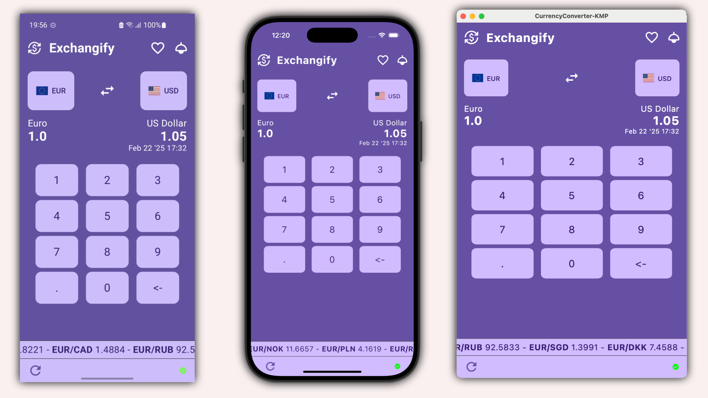

It is a simple yet powerful currency converter app designed to help you convert currencies effortlessly. The app uses real-time exchange rates to provide accurate conversions between a wide range of world currencies.


## Features

- Real-time currency conversion.
- Supports many world currencies.
- Easy-to-use, intuitive interface.
- Offline mode for conversion without internet connection (using the last fetched rates).
- Favorites list to quickly access your most-used currencies.

### Screenshots

<div style="display: flex;">
    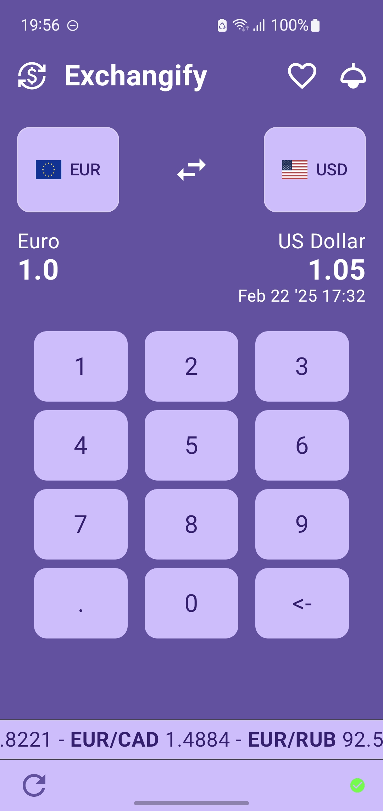
&nbsp; &nbsp; &nbsp; &nbsp;
    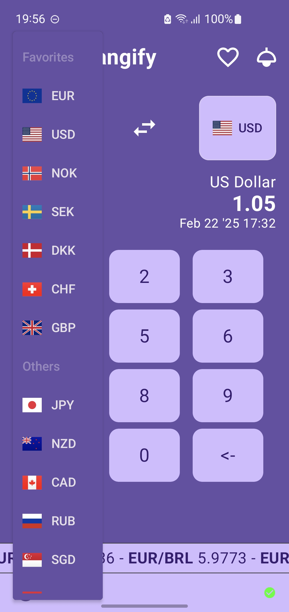
&nbsp; &nbsp; &nbsp; &nbsp;
    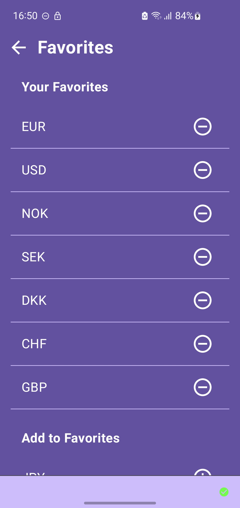
&nbsp; &nbsp; &nbsp; &nbsp;
    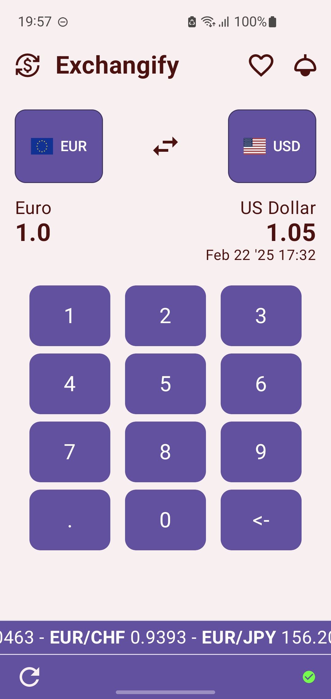
&nbsp; &nbsp; &nbsp; &nbsp;
    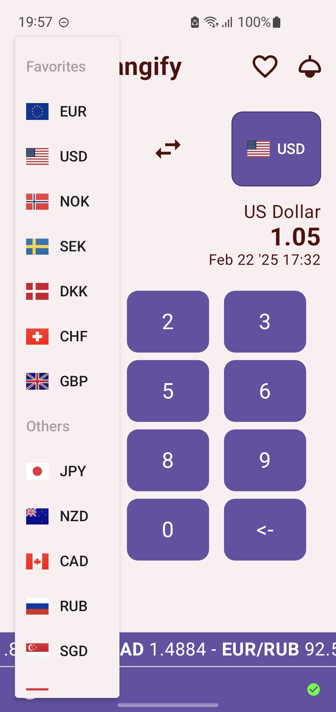
&nbsp; &nbsp; &nbsp; &nbsp;
    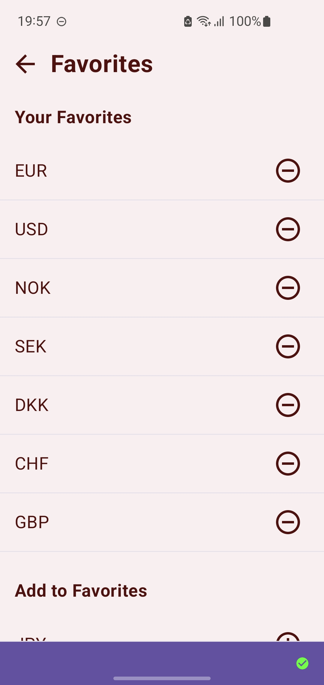
</div>

### Usage
Select the currency you want to convert from, enter the amount, and select the currency you want to convert to. The app will display the converted amount based on the current exchange rate.

## Tech Stack

This is a **Kotlin Multiplatform** project targeting Android, iOS and Desktop.

**Exchangify** - Currency Converter - KMP is built using a modern stack of technologies designed to offer robust performance and scalability:
- **Compose Multiplatform**: For building native UIs.
- **Ktor**: For network operations.
- **Room Database**: For local data storage.
- **MVVM (Model-View-ViewModel)**: Architectural pattern.
- **DI Koin**: Dependency injection.
- **DataStore**: For Android data storage and management.
- **NSUserDefaults**: For iOS data storage and management.
- **Nav 3**: For navigating between screens.
- **Material 3**: Latest Material Design components.

## Architecture

**Exchangify** - Currency Converter - KMP follows the [Google's official architecture guidance](https://developer.android.com/topic/architecture).
<br/><br/>
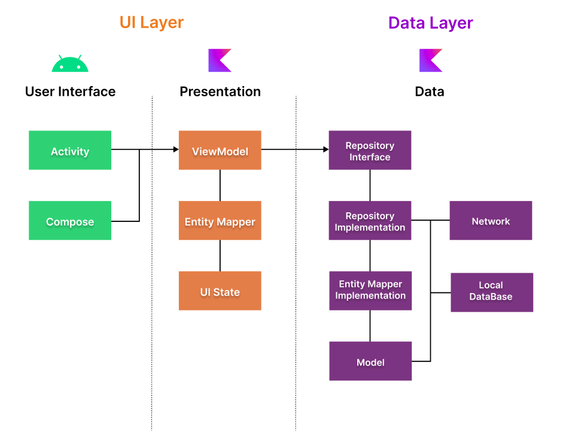
<br/><br/>
Exchangify - Currency Converter - KMP was built with [Guide to app architecture](https://developer.android.com/topic/architecture), so it would be a great sample to show how the architecture works in real-world projects.
<br/><br/>
The overall architecture is composed of two layers; UI Layer and the data layer. Each layer has dedicated components and they each have different responsibilities. The arrow means the component has a dependency on the target component following its direction.
<br/><br/>

### Architecture Overview
<br/><br/>
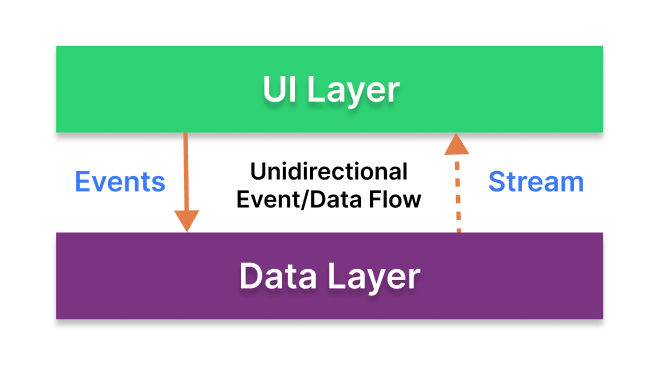
<br/><br/>
Each layer has different responsibilities below. Basically, they follow [unidirectional event/data flow](https://developer.android.com/topic/architecture/ui-layer#udf).
<br/><br/>

### UI Layer
<br/><br/>
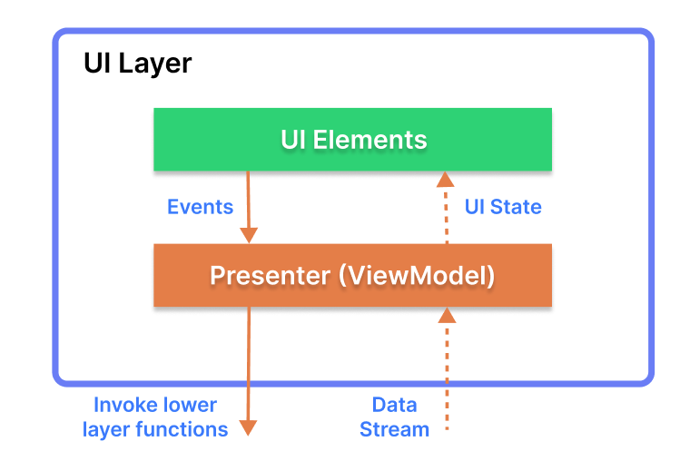
<br/><br/>
The UI Layer consists of UI elements like buttons, menus, tabs that could interact with users and [ViewModel](https://developer.android.com/topic/libraries/architecture/viewmodel) that holds app states and restores data when configuration changes.
<br/><br/>

### Data Layer
<br/><br/>
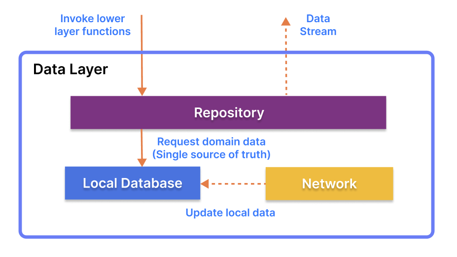
<br/><br/>
The data Layer consists of repositories, which include business logic, such as querying data from the local database and requesting remote data from the network. It is implemented as an offline-first source of business logic and follows the [single source of truth](https://en.wikipedia.org/wiki/Single_source_of_truth) principle.

## Development

### Project structure

- `composeApp`: shared UI and business logic, platform implementations, Room schemas and Koin/Room code generation.
- `androidApp`: Android Activity, Application, manifest and APK configuration.
- `desktopApp`: desktop launcher and native distribution configuration.
- `iosApp`: Xcode application consuming the `ComposeApp` framework.

The `jvm("desktop")` target and `desktopMain` implementations remain in `composeApp`.
Keep `iosX64()` and its KSP dependencies for iOS Simulator development on Intel Macs.
The Lifecycle version remains pinned until any replacement is verified to publish compatible `iosX64` artifacts.

### Android

Run the `androidApp` configuration in Android Studio. To build its debug APK:

```sh
./gradlew :androidApp:assembleDebug
```

### Desktop

Run the desktop application:

```sh
./gradlew :desktopApp:run
```

Compile and build the desktop JAR:

```sh
./gradlew :desktopApp:jar
```

Create an application directory with a bundled runtime, or a macOS installer:

```sh
./gradlew :desktopApp:createDistributable
./gradlew :desktopApp:packageDmg
```

Desktop outputs are under `desktopApp/build/`. Native installers are built on the corresponding operating system.

### iOS

The Xcode build phase invokes `:composeApp:embedAndSignAppleFrameworkForXcode`.
Use the existing `iosApp` Xcode project to build and run on the selected device or simulator.
For a standalone debug framework, choose the task matching the destination:

```sh
# iOS Simulator on an Intel Mac
./gradlew :composeApp:linkDebugFrameworkIosX64

# iOS Simulator on an Apple Silicon Mac
./gradlew :composeApp:linkDebugFrameworkIosSimulatorArm64

# Physical iPhone or iPad
./gradlew :composeApp:linkDebugFrameworkIosArm64
```

Native compilation caching uses Kotlin's defaults. When validating a toolchain update, build and run the Intel simulator app, then rebuild after a small Kotlin change to check incremental builds with caching enabled.

### Generated code and manual checks

Normal builds run Koin and Room code generation. If generated Koin imports are missing, rerun metadata generation:

```sh
./gradlew :composeApp:kspCommonMainKotlinMetadata --rerun-tasks
```

Then build the affected platform. A routine rebuild does not require `clean`.

Before merging, check currency conversion, navigation, favorites and theme persistence, and offline behavior on Android, desktop and the Intel iOS Simulator. Also launch the packaged desktop application to verify its bundled runtime, resources and database support.

### License
Designed and developed by Vladan Mitkovic (2024)

Licensed under the Apache License, Version 2.0 (the "License");
you may not use this file except in compliance with the License.
You may obtain a copy of the License at

http://www.apache.org/licenses/LICENSE-2.0

Unless required by applicable law or agreed to in writing, software
distributed under the License is distributed on an "AS IS" BASIS,
WITHOUT WARRANTIES OR CONDITIONS OF ANY KIND, either express or implied.
See the License for the specific language governing permissions and
limitations under the License.
